# HELIOS (Health Evaluation and Life Indicators Observation System) 
A 3D health twin for astronauts. Instead of treating the body as a picture, the app treats it as
a **data structure**: every body system (skeletal, cardiovascular, muscular...) is an object with
live health indicators, and its status drives its color on an interactive 3D body.
Built for the NASA Space Apps Challenge 2026, challenge
*Create Health Monitoring Software for Astronauts on Space Missions*.

## Demo & Visual Walkthrough

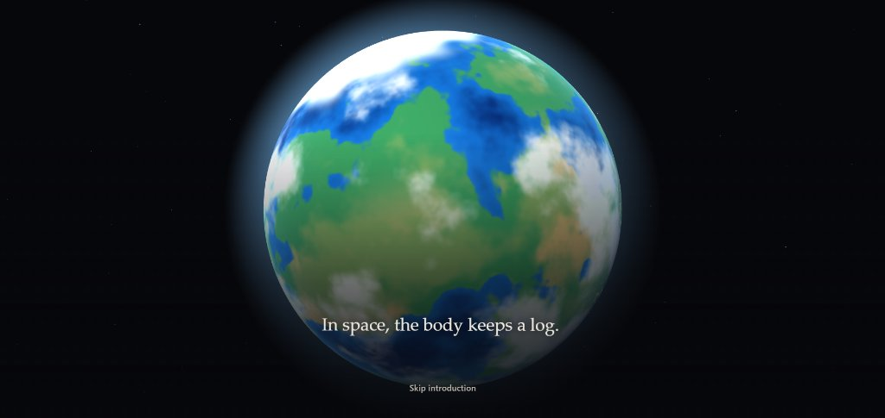
*1. Cinematic 3D intro sequence: procedural Earth shader and opening mission narrative.*

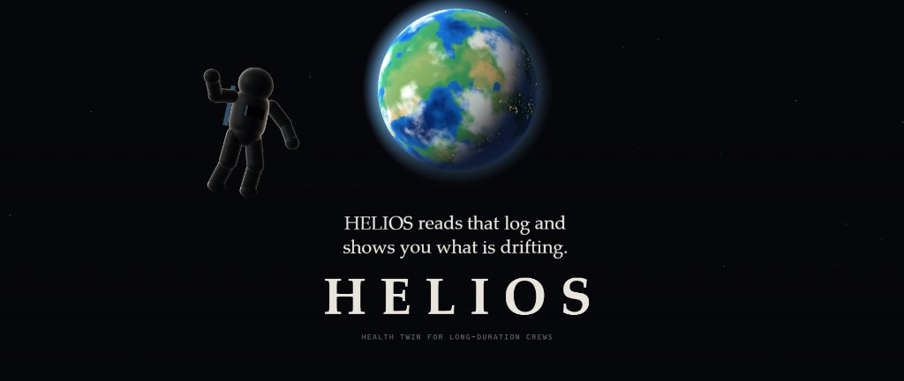
*2. Astronaut arrival: introducing the health twin concept for long-duration crews.*

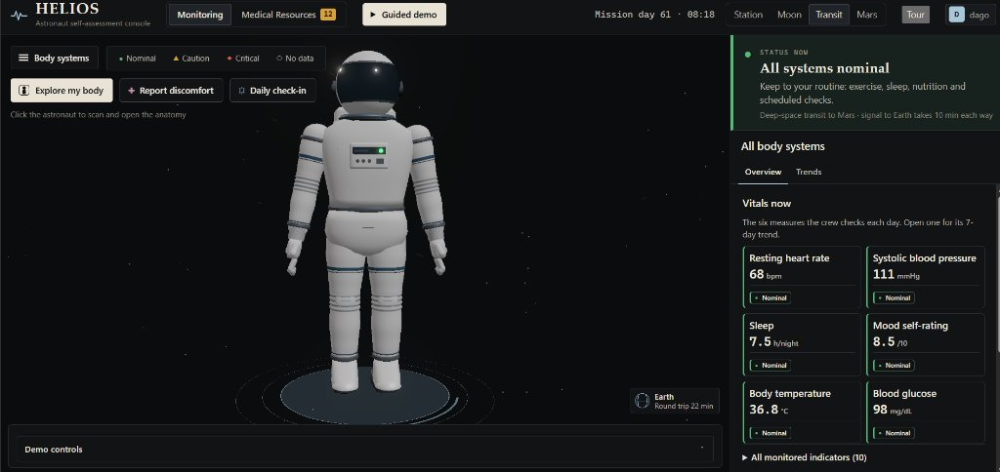
*3. Astronaut health twin dashboard: nominal status, live vitals summary, and mission environment context with light-speed communications delay.*

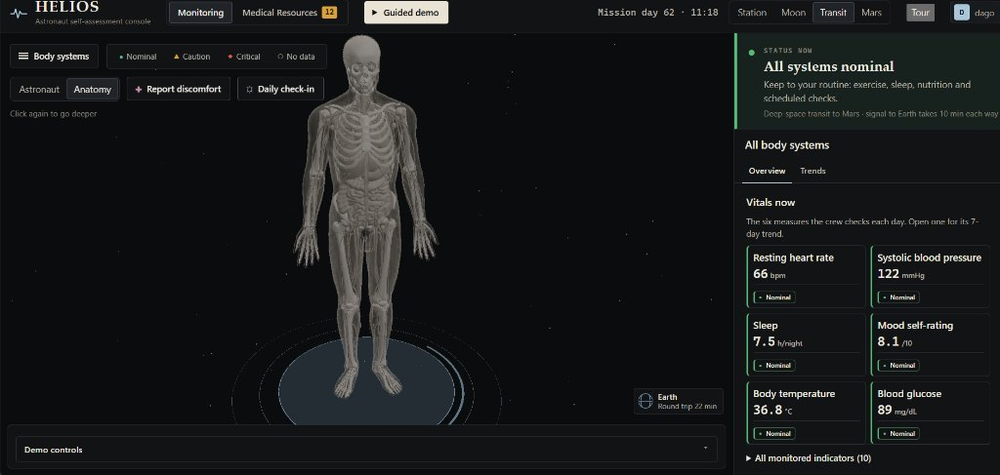
*4. Anatomical 3D digital twin: BodyParts3D atlas decomposed into interactive physiological systems and multi-depth anatomical layers.*

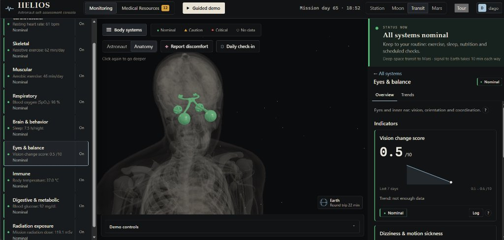
*5. Targeted system inspection: selecting "Eyes & balance" isolates the sensory organs in 3D and visualizes relevant SANS indicators and balance metrics.*

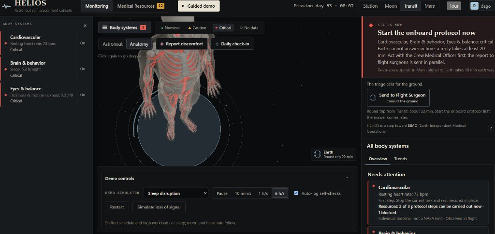
*6. Critical alert & Earth-Independent Medical Operations (EIMO): deep-space communication latency triggers autonomous onboard action protocols while affected cardiovascular systems illuminate in red in 3D.*

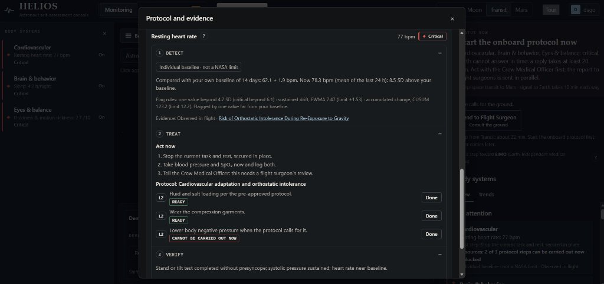
*7. Closed clinical loop (Detect → Treat → Verify): individual baseline drift detection (EWMA/CUSUM), NASA evidence provenance, authority-tiered treatments, and objective verification requirements.*

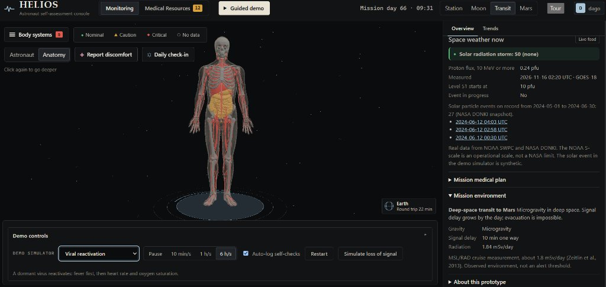
*8. Real space weather & multi-system telemetry: live GOES-18 proton flux (NOAA SWPC), NASA DONKI solar particle event tracking, and anatomical 3D status coloring (amber caution, red critical).*

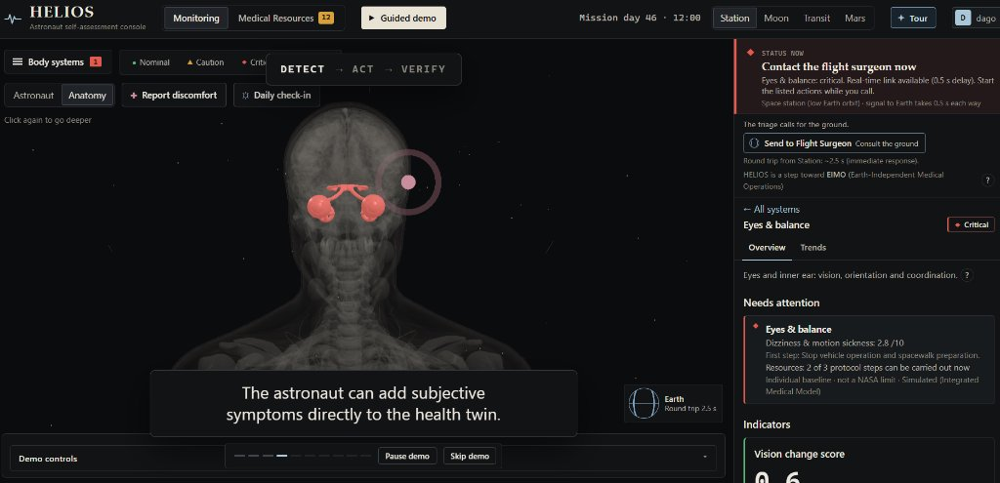
*9. Spatial symptom reporting & guided mission tour: pinning subjective discomfort directly on the 3D anatomy with real-time station-to-ground telemetry triage.*

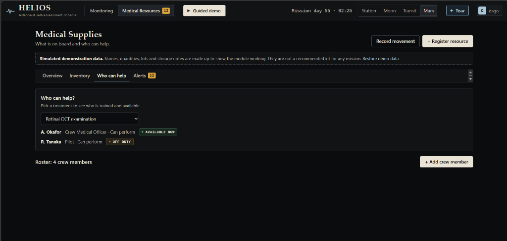
*10. Resource Intelligence & crew capability matching: verifying in-flight medical inventory and certified crew availability (e.g. retinal OCT examination for SANS) before executing protocols.*

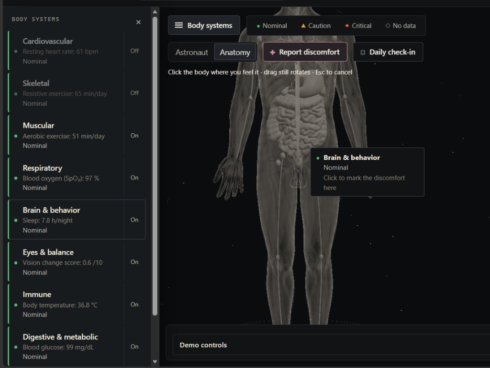
*11. Interactive discomfort reporting & layer toggling: raycast-based 3D body picking to pinpoint localized pain or symptoms, with selective anatomical layer visibility.*

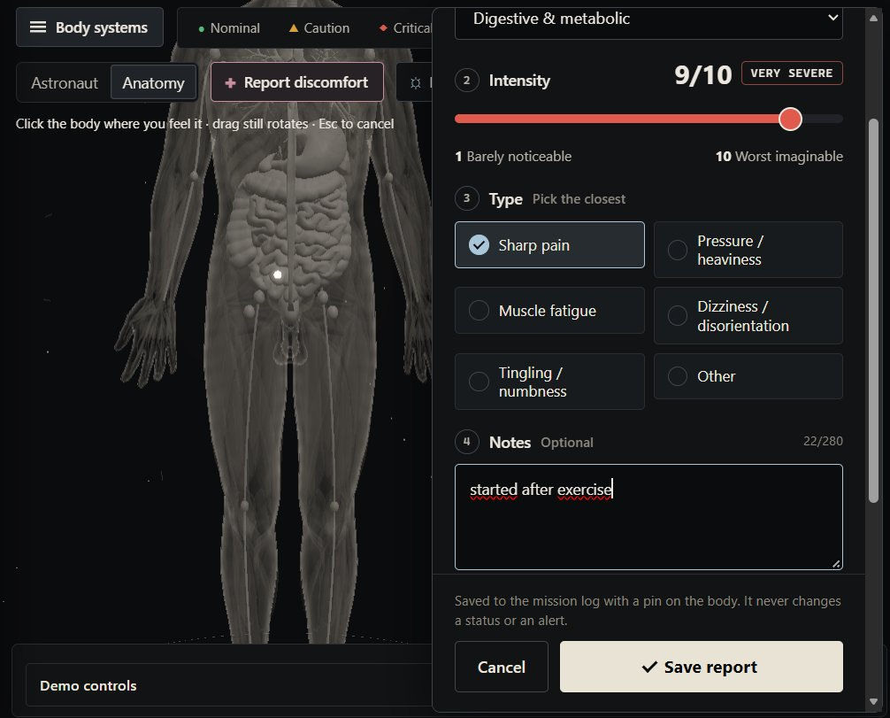
*12. Clinical symptom recording: 3D spatial pin placement, 1–10 severity slider, pain classification, and contextual notes (logged as clinical observation without biasing objective rule engines).*


## What it does

- **Anatomical 3D body, one layer per system.** Real bones, muscles, vessels and organs from
  the BodyParts3D atlas, grouped into nine systems, each colored by its current status:
  nominal, caution or critical. Click a system on the body or in the list; click the same spot
  again to go one layer deeper. Layers can be hidden.
- **Detect, Treat, Verify.** Every indicator card follows the same loop. *Detect* shows the
  value, the status and where the threshold comes from. *Treat* lists the protocol steps with
  their authority level, from a reversible environmental action (level 1) to an emergency
  protocol (level 4). *Verify* closes an action only when the indicator is measured back in
  range; an action that was merely carried out stays pending.
- **Provenance on every alert.** Only two thresholds are NASA limits: cabin CO₂ (NASA-STD-3001
  Vol. 2 [V2 6004], 3 mmHg) and retinal thickness (NASA SANS clinical criteria, 20 and 55 µm).
  Every other range is labeled as not a NASA limit. Each rule lists its evidence with the class
  of provenance (observed in flight, ground analog, simulated, standard...), sample size,
  effect, confidence interval and a source that opens.
- **Compared with yourself, where NASA sets no limit.** Eleven indicators (heart rate, sleep,
  temperature, mood, exercise...) are judged against the crew member's own first 14 days, not
  against a general range. Three rules raise a flag: one value far from the baseline, a
  sustained drift (EWMA) and an accumulated change (CUSUM). Their limits are calibrated, not
  chosen: about 4% chance of a false caution per indicator per 30 days. The card shows the
  baseline, how far the value is from it, and which rule fired.
- **Real space weather.** The app reads the GOES proton flux from NOAA SWPC, places it on the
  NOAA S-scale and lists the solar particle events on record in NASA DONKI. It uses the live
  feed when there is a connection and a bundled snapshot when there is not.
- **Decision support, not prescription.** Medication steps are withheld unless the mission
  medical plan pre-authorizes drugs. That switch is off by default.
- **Sixteen indicators** (heart rate, blood pressure, SpO2, cabin CO₂, sleep, mood, exercise,
  retinal thickness, glucose, radiation dose, solar proton flux...). Each one explains why it
  matters in space and how to measure it.
- **"What should I do?"** A triage verdict answers the challenge question of when a result needs
  the crew or the flight surgeons. The same finding gives a different instruction depending on
  distance from Earth: on the station, *contact the flight surgeon now*; on Mars, where a reply
  takes 40 minutes, *start the onboard protocol now*.
- **Trends, not only values.** 7-day charts with status bands, and an early warning when a value
  is still nominal but heading out of range.
- **Self-check prompts.** Indicators the astronaut measures by hand become "due" on a schedule.
- **Four environments**: space station, lunar base, Mars transit, Mars surface. They change the
  radiation dose rate, gravity and signal delay.
- **Demo simulator** with seven scenarios (exercise device failure, sleep disruption, viral
  reactivation, SANS signs, solar particle event, CO₂ removal fault, under-eating) and a fast
  mission clock. Marking a protocol step as done makes the simulated indicator recover, so the
  Verify step can be seen working.

## Rules, evidence and sources

The rules come from a research report on NASA and partner-agency sources, transcribed into
data that the app, the tests and a SQLite database all read:

| File | Content |
|---|---|
| `data/matrix/rules.json` | 11 Detect-Treat-Verify rules (10 from the report, 1 added by the project and flagged) |
| `data/matrix/evidence.json` | 35 evidence claims with provenance class, n, effect, 95% CI and p |
| `data/matrix/sources.json` | 29 sources: 28 re-located in NASA NTRS, Crossref or by URL, 1 not located and flagged |
| `reference_map.csv` | every claim linked to a source that resolves, with its verification status |
| `data/snapshots/` | saved responses of the external sources, for offline use |

Status in `reference_map.csv`: `verificado` means the key figure was found in the abstract of
the source; `fuente_localizada` means the source was found but the figure was not confirmed
(it may be in the full text). Most claims are in the second group.

```bash
npm run sources:smoke   # test every external source and save snapshots
npm run ingest:space-weather   # refresh the bundled GOES and DONKI snapshot
npm run refs:verify     # re-locate sources and rebuild reference_map.csv
npm run db:build        # build data/crew-health.db from data/matrix
npm run validate         # reproduce every number in METHODS.md (about three minutes)
```

**Statistics and their validation are in [METHODS.md](METHODS.md)**: the individual baseline,
the EWMA and CUSUM drift detectors and the single-value rule, how their limits were
calibrated, what the anomaly-injection study and the MMASH data show, and the limitations.
The app classifies with the same library and the same calibrated limits that are validated
there. The price of few false alarms is stated plainly: a small drift takes days to flag.

Data provided by the NASA STI Program (NTRS), NOAA SWPC, NASA DONKI, NASA OSDR and PhysioNet.

## API and offline demo

The same rules engine is available over HTTP for local use (no authentication, one crew
member). Alerts, interventions and their verification are also written to SQLite.

```bash
npm run db:build
npm run api             # http://localhost:8787
```

| Endpoint | Returns |
|---|---|
| `GET /rules`, `GET /rules/{id}` | the Detect-Treat-Verify matrix; one rule with its evidence |
| `GET /evidence?rule=&provenance_class=` | evidence claims with provenance class, n, effect, CI, source and verification status |
| `GET /state/crew-1` | status of every system and indicator, triage verdict, self-checks due; for indicators judged against the individual baseline, the baseline and the three rules |
| `GET /radiation/now` | real proton flux, NOAA S level, whether an event is in progress |
| `GET /alerts` | current alerts; each one carries its provenance class and source |
| `GET /verify`, `POST /verify` | interventions and their measured outcome; record a treatment step |
| `POST /measurements`, `POST /simulate`, `PUT /medical-plan` | log a reading; advance the mission or change scenario; pre-authorize drugs |

`POST /verify` refuses any medication step with 403 while the medical plan does not
pre-authorize drugs.

```bash
npm run demo:check      # prove that nothing needs a connection
npm run demo:offline    # the same checks, then serve the dashboard (4173) and the API (8787)
```

The check verifies the snapshots against their SHA-256, builds the database and the site,
confirms that the only network request in the source is the optional live space weather
feed, and runs the engine and the API with the network blocked.

## Run it

Requires Node 22 or newer.

```bash
npm install
npm run dev      # http://localhost:5173
npm test         # rules engine and simulator tests
npm run build    # static site in dist/
npm run model:vosk   # reinstall the offline voice model for dictation (already in the repo)
```

The build is a static site with relative paths: publish `dist/` on GitHub Pages, Vercel or
Netlify as is.

### Rebuilding the 3D model (optional)

`public/models/body.glb` (2.3 MB) is committed, so this step is only needed to change how the
atlas is reduced or grouped. Download `isa_BP3D_4.0_obj_99.zip`, `isa_element_parts.txt` and
`partof_element_parts.txt` from the
[BodyParts3D download page](https://dbarchive.biosciencedbc.jp/en/bodyparts3d/download.html)
into `assets-src/bodyparts3d/`, unzip the archive into `assets-src/bodyparts3d/obj/`, then:

```bash
npm run build:model
```

### 30-second demo script

1. Open the app: the body rotates, everything is green (*All systems nominal*).
2. Scenario **Viral reactivation**, speed **6 h/s**. The immune system turns amber, then red;
   the lungs go amber; the verdict escalates.
3. Click **Immune**: fever chart crossing the bands, and the list of actions.
4. Switch **Station -> Mars**: the verdict changes from "contact the flight surgeon" to "start
   the onboard protocol", because Earth can no longer answer in time.

## Architecture

Data flows one way. No layer reaches back into the one before it.

```
 sources                store                 rules engine              views
+----------------+    +--------------+    +---------------------+    +----------------------+
| SimulatedSource| -> | HealthStore  | -> | domain/engine       | -> | scene/  3D body      |
| manual log     |    | readings,    |    | classify, trend,    |    | ui/     panels,charts|
| (real sensors) |    | selection... |    | system status,triage|    +----------------------+
+----------------+    +--------------+    +---------------------+       | select / hover / log
        ^                    ^                                          |
        +--------------------+------------------------------------------+
                                actions only
```

| Folder | Responsibility | May import |
|---|---|---|
| `src/domain/` | The model and the rules. Systems, indicators and environments are **data** (`catalog/`); `engine/` turns readings into statuses, trends and a triage verdict. Pure TypeScript. | nothing |
| `src/data/` | `HealthStore` (single source of truth, typed events), `MissionClock`, `GroundLink` (plays flight surgeon consultations on time), and reading sources behind the `SensorSource` interface. | `domain` |
| `src/scene/` | three.js. `BodyModel` is the contract "one layer per system". `GltfBody` implements it with the anatomical model; `ProceduralBody` implements it from primitives and is the fallback if the model cannot load. `SystemVisuals` is the only place where status becomes color in 3D; `Picker` handles clicks. | `domain`, `data` |
| `src/speech/` | Offline voice dictation. `DictationController` is the state machine and knows no recognizer; `vosk/VoskEngine.ts` is the only file that imports Vosk. The store and the domain never import this folder (a test checks it). | `speech` only |
| `src/ui/` | DOM panels and canvas charts. | `domain`, `data`, `speech` (types and controller) |
| `src/main.ts` | Composition root: the only file that knows every layer. | all |
| `tools/` | Offline build of the 3D model: classifies the atlas parts by body system (`bodyparts/classify.mjs`), simplifies them and writes `public/models/body.glb`. | - |

Where to extend:

- **New indicator or body system**: add an entry in `src/domain/catalog/`. The list, the panels,
  the charts and the triage pick it up. A new system also needs a geometry builder in
  `src/scene/procedural/parts/`.
- **Real sensors** (BLE wearable, dosimeter, the phone's accelerometer): implement
  `SensorSource` and call `store.ingest()`. Nothing else changes.
- **Another body model** (a female body, a higher-detail atlas): implement `BodyModel`, or
  point `tools/build-body-model.mjs` at different meshes. The scene, picker and UI stay as
  they are.
- **Mission-specific reference ranges**: `EnvironmentDef.thresholdOverrides`.

### The introduction

The first visit opens with a short film (`src/intro/`): the camera leaves a procedural Earth, an astronaut
drifts into view, and three lines explain why the app exists. A welcome card then asks for a name and,
optionally, the mission habitat, which selects the starting environment.

- Three.js draws the scene (`src/intro/scene/`): the Earth, its atmosphere, the stars and the astronaut are
  shaders and simple geometry, with no textures or network requests, so it works offline.
- GSAP directs the camera and the text (`src/intro/IntroExperience.ts`). The scene exposes plain numbers
  (`IntroSceneState`) and the timeline tweens them.
- The name and habitat are kept in `localStorage` only. Later visits go straight to the console; the name in
  the top bar, or `?intro` in the address, replays the film.
- With "reduce motion" enabled, the film becomes a single still frame with all the text shown at once.

### The health twin: astronaut, scan, anatomy

The dashboard opens on a friendly astronaut; the anatomy appears only when the crew member asks for it.

- `HealthTwin` (`src/scene/HealthTwin.ts`) holds two layers, the suit (`AstronautSuit`) and the anatomy
  (`BodyModel`), and three views: `astronaut`, `scan` (the anatomy through a holographic suit) and `anatomy`.
- "Explore my body" turns the camera to the front, thins the suit and brings the anatomy up system by system.
  GSAP eases opacities and the camera only; the Three.js frame loop is unchanged.
- The suit is visual only. Picking still goes through `Picker.ts` and `body.glb`; while the astronaut is shown
  there is nothing to pick.
- In `anatomy` the body rests in a neutral grey-blue; a system shows its status color only when it is selected
  or needs attention. In `scan` the suit is a hologram (22% opacity) and every system is faint except the
  selected one.
- A see-through suit is drawn in two passes, depth then color (`suit/SuitFade.ts`), so overlapping parts of
  the suit do not show through each other.
- The astronaut is modelled in code (`src/scene/suit/ProceduralSuit.ts`, built with the small kit in
  `suit/shapes.ts`). A `public/models/astronaut.glb`, if added, replaces it automatically (see
  `public/models/README.md`).
- Clicking the astronaut starts the exploration, like the button. The click still goes through `Picker.ts`:
  `HealthTwin.pickTarget` hands it the suit while the astronaut is shown and the anatomy afterwards.
- The figure breathes, and drifts very slightly in microgravity (station, transit). Reduced motion turns
  both off and makes every transition immediate.

### Play the Mission (guided demo)

`▶ Guided demo`, in the top bar (or `?demo` in the address), plays one health episode in about 90
seconds: the astronaut, the scanner, a change detected, a symptom pinned on the body, "What should I do
now?", a consultation from the station, the same consultation from Mars, the onboard protocol, and the
verification.

- `src/demo/MissionTour.ts` is a conductor only. It calls the same `AppActions` and store methods the crew
  member uses; it holds no clinical logic and writes no reading or status of its own.
- It is deterministic: the simulator is reseeded, the clock is stopped and mission time moves in fixed steps
  (`AppActions.advanceMission`), so every run shows the same thing and can be recorded.
- `src/ui/MissionTourStage.ts` draws it: subtitles (`MissionCaption`), the Detect → Act → Verify marker, the
  station/Mars delay card, the before/action/after card, pause and skip. Skipping at any point restores a
  fresh nominal mission in the environment the viewer had.

### Interface tour (spotlight)

A `Tour` button in the top bar (and an invitation on first visit) runs a 30-second spotlight tour of the
interface: each control is highlighted with a dark mask and a cyan halo, a floating card explains it, and
the tour advances automatically after ~4.5 s per step. Esc, ←/→, Skip and Pause are supported; clicking the
highlighted control advances to the next step. The tour is lazy-loaded and restores any state it changed.

### Loss of signal: store and forward

`GroundLink` can lose the link (`beginLoss`) and get it back (`restore`); the store holds the
`CommunicationWindow` (`src/domain/link.ts`). The simulator bar has a control for it.

- While Earth is unreachable (LOS), the Earth badge says so, a banner reads "Onboard protocol first" with a
  countdown to the next contact window, and "Send to Flight Surgeon" becomes "Queue for next contact".
- The report is packed at once and kept on board. At acquisition of signal (AOS) it is sent automatically,
  as it was packed. Every step is written to the mission history. The triage is not involved.

### Episode record (SOAP)

The store keeps a mission history (`missionLog`): status changes, reports, guidance shown, protocol steps,
verifications, consultations and link events, each with its source. `src/domain/episode.ts` turns it into
episodes: one opens when a body system leaves nominal and closes when it is measured back. Each is shown as
a SOAP note (Subjective, Objective, Assessment, Plan) and a timeline, and can be exported as JSON or as a
plain-text summary. The assessment is the status and triage the rules produced; no diagnosis is added.

### Daily check-in

"Daily check-in", beside the 3D view: what changed since yesterday (at most three items, only beyond the
person's own day-to-day variation), three quick questions, and the plan for the day, assembled from tasks
that already exist (active protocol steps, pending verifications, due self-checks, exercise targets). The
answers are saved as given and change no status.

### What should I do now? (after a discomfort report)

Saving a report opens a window that answers that question first, in four steps: immediate action,
recommended self-check, what to monitor, when to escalate (`src/domain/symptomGuidance.ts`,
`src/ui/SymptomGuidanceDialog.ts`).

- Nothing in it is written by the interface. Each line is taken from the triage verdict, the rules matrix,
  the self-checks the catalog files under the reported body system, the current readings or the mission
  environment, and carries a label saying which: measured, reported, onboard protocol, triage, self-check,
  mission context, known mission risk, not known.
- The hazards NASA's Human Research Program tracks for the reported body system are listed as context, with
  a link, and never as a cause. The window says so in plain words.
- Its color follows the triage: self-check recommended, attention recommended, immediate action required.
  When the situation calls for the ground it offers the existing "Send to Flight Surgeon" flow, after the
  onboard protocol, and far from Earth it says not to wait for the answer.

### Reporting discomfort on the body

"Report discomfort" (above the 3D view) turns the next click on the body into a pin instead of a selection.

- `Picker.ts` returns the body systems under the pointer and the nearest surface point; `BodyViewport` converts
  that point to the body's own frame and hands it to the store as plain `{x, y, z}`.
- The model lives in `src/domain/symptoms.ts` (no Three.js, no DOM): intensity 1–10, type, optional notes.
- `HealthStore.reportSymptom()` adds it to the mission log and emits `symptoms`; `SymptomMarkers` draws the pins,
  the overview lists the reports and the trend chart marks them on the time axis.
- A report is an observation. It **does not change any status, threshold or triage level**: there is no validated
  rule linking a reported pain to a finding, so none was added. It only suggests the self-checks the catalog
  already files under the same body system (and the dizziness score when dizziness is reported).

### Dictating the notes, offline

The notes field of the report has a **Dictate** button. Speech is recognized on the device by
[Vosk](https://alphacephei.com/vosk/) (Kaldi compiled to WebAssembly) in a Web Worker: audio and
transcripts never leave the browser, and no cloud service or browser `SpeechRecognition` is used.

- States: idle → loading model → listening (live words shown as they are recognized) → processing →
  transcript ready, or error. Esc stops listening; the button, status line and suggestions work from the keyboard.
- The transcript goes into the notes as ordinary text and focus moves there, so it is reviewed and
  edited before "Save report". The report cannot be saved while dictation is still running.
- Speech is never turned into a diagnosis: the type, body system and intensity stay as the crew member set
  them. If the notes (typed or dictated) mention dizziness or vision problems, the related self-check is
  **suggested** with an unticked box; only a ticked one is added to the report (`src/domain/noteSuggestions.ts`,
  a keyword match that ignores negations such as "no dizziness").
- Microphone problems get a plain explanation and a way forward: permission blocked, no microphone, device busy,
  page not on https, model not installed.
- The model (`public/models/vosk/vosk-model-small-en-us-0.15.tar.gz`, 39 MB, in the repository;
  `npm run model:vosk` reinstalls it) is only loaded on the first press, then kept unpacked in
  IndexedDB for offline use. See
  [`public/models/vosk/README.md`](public/models/vosk/README.md).

### Send to Flight Surgeon, and why distance matters (EIMO)

When the triage escalates to the ground (a critical finding), or a treatment was not verified and
the protocol says "move to the next authority level", a **Send to Flight Surgeon** button appears
under the verdict: status and what to do come first, the consultation second, the details after.

- **Latency** reuses the environment model: 2 × `commsDelaySec` of light travel (the value the triage
  already uses) plus `linkHandlingSec` for relays and ground handling (`src/domain/consult.ts`).
  Station about 2.5 s, Moon about 11 s, transit about 22 min, Mars about 44 min.
- Pressing it packs a short medical summary and plays the link: preparing transmission, sending the
  summary, signal en route, awaiting the response, response received, with a countdown. Waits of
  20 s or less play in real time; longer ones are compressed to about 30 s and labeled
  "Demo playback accelerated ×88", while the text keeps the real delay.
- A small Earth sits in the corner of the 3D view, smaller the farther the mission is, with the
  round trip under it. The signal leaves the crew, reaches Earth and the answer travels back
  (`src/ui/EarthLink.ts`); with reduced motion the path and states stay and nothing moves.
- The answer is assembled from the onboard protocol for the data that was sent, and says so. It adds
  no diagnosis and never offers a drug the medical plan withholds. Statuses, thresholds, baselines,
  EWMA/CUSUM and the triage are not touched.
- The mission history records "consultation requested", "signal sent", "awaiting Earth response"
  and "Earth response received" at their link times (a Mars reply is logged 44 min after the
  request, whatever the demo speed). They appear in the overview and as markers on the trend chart.
- Under the panel: *HELIOS is a step toward EIMO (Earth-Independent Medical Operations)*, with the
  delay ladder of every environment behind its "?": the longer the wait for Earth, the more the
  crew must be able to act alone first.

### The side panel

The triage verdict stays on top; two tabs (`src/ui/panel/`), Overview and Trends, follow the body system
selected in 3D. Protocol and evidence open in their own window from any alert, indicator or trend:

1. **Overview**: active alerts, then one compact card per indicator (value, unit, status, 7-day sparkline).
   Explanations sit behind a "?" button; mission background is folded away.
2. **Trends** (`TrendChart.ts`): one indicator over 24 h, 7 days, 14 days or the recorded mission, with the
   person's usual range (95%) when a baseline exists, a point readout (time, value, z-score), markers for
   treatments and reported discomfort, and an optional second indicator on its own axis.
3. **Protocol & evidence**: the collapsible Detect → Treat → Verify loop, authority levels, citations and
   evidence class, for the selected indicator or system only.

### Medical Resources (HELIOS Resource Intelligence)

A second section of the app, next to Monitoring in the top bar: what is on board, what state it is in, who is
trained to use it, and whether the approved protocols can be carried out with it.

| Layer | Where | What it holds |
| --- | --- | --- |
| Rules | `src/domain/resources/` | Types, movement rules, validation, findings and alerts, CSV/JSON import, the readiness engine. No DOM, no storage. |
| Storage | `src/data/resources/` | `ResourceRepository` (IndexedDB in the app, memory in tests) and `ResourceStore`, the one service that changes anything. |
| Screens | `src/ui/resources/` | Overview, Inventory, Who can help, Alerts, and the dialogs. Loaded the first time the section is opened. |

- **Offline-first.** Records live in IndexedDB (`helios-medical-resources`): they survive reloads and need no
  connection. Every write is one transaction, so a movement and the count it produces are saved together.
- **Auditable.** A count only changes through a movement. Movements are added, never edited or deleted;
  a record that is no longer used is deactivated and keeps its history.
- **Resource Intelligence.** `readiness.ts` checks each step of a protocol from the existing
  Detect → Treat → Verify matrix against the inventory and the roster: usable items, calibration and
  inspection in date, free quantity, crew with a current certification who are available. The result appears
  inside each protocol (Monitoring → Protocol & evidence → "Resources and crew") and as a table in the
  resources overview. It never proposes a drug, a dose or a substitute: an alternative is used only when the
  protocol's own requirements list it, and a medication step stays withheld unless the medical plan
  pre-authorizes drugs, whatever is on board.
- **Simulated configuration and data.** What each protocol step needs (`protocols.ts`) and the demonstration
  kit and roster (`seed.ts`) are made up to show the module working, and are labelled as simulated on screen.
  In a real mission both come from the flight surgeon and the manifest.
- **QR.** Each record's identifier is also its QR code (`HELIOS:RES:<id>`), shown in its details. "Find by
  code" accepts a typed identifier or a handheld scanner, and uses the camera where the browser supports
  `BarcodeDetector`.
- **Sync, later.** Every write is also appended to an `outbox` store, in order. Nothing drains it yet: it is
  the hook for a delay-tolerant (DTN) bundle agent.

### The 3D body

The body is built from [BodyParts3D](https://dbarchive.biosciencedbc.jp/en/bodyparts3d/desc.html),
an atlas of about 2,200 anatomical parts of an adult male, each tagged with its concept in the
Foundational Model of Anatomy (FMA). That classification is what lets the build script sort
parts into body systems by rule instead of by hand: "is a bone organ" goes to the skeletal
system, "is part of the heart" goes to the cardiovascular system, and so on. The result is one
mesh per system part, 0.7 million triangles in a 2.3 MB file.

Three things are not in the atlas and are added by this project: lung outlines (the convex
hull of each lung's bronchi and vessels), lymph nodes and inner ears (drawn at run time at
positions taken from the model's own bones). See `public/models/README.md` for the full list
of changes.

## NASA and partner resources used

- NASA Human Research Program, *5 Hazards of Human Spaceflight*: https://www.nasa.gov/hrp/hazards/
- NASA Human Research Program, *Risks of Human Spaceflight*: https://www.nasa.gov/hrp/risks/
  (each body system links to the HRP risk it tracks)
- NASA-STD-3001, career radiation exposure limit of 600 mSv
- Canadian Space Agency, *Monitoring radiation for astronaut health*:
  https://www.asc-csa.gc.ca/eng/news/articles/2026/2026-02-26-monitoring-radiation-astronaut-health.asp

3D anatomy:

- **BodyParts3D, © The Database Center for Life Science licensed under CC Attribution 4.0
  International.** https://dbarchive.biosciencedbc.jp/en/bodyparts3d/desc.html
  The meshes were simplified, regrouped and rescaled; details in `public/models/README.md`.

Other references for the simulator and reference ranges:

- Zeitlin et al. (2013), MSL/RAD cruise dose rate; Hassler et al. (2014), Mars surface dose rate
- Zhang et al. (2020), Chang'E-4 lunar surface dose rate
- Barger et al. (2014), sleep duration on the ISS
- General clinical ranges: American Heart Association / ACC (heart rate, blood pressure),
  American Diabetes Association (glucose), AASM/SRS (sleep)

## Limits

- **All crew readings are simulated.** No real sensor is connected yet. Space weather is the
  only real data, and the solar event in the demo simulator is synthetic.
- DONKI needs a personal api.nasa.gov key (`NASA_API_KEY`); without it the events listed are
  those of the bundled snapshot.
- **The individual baselines come from simulated days**, and a sudden change in a sensor is
  seen through its 24-hour mean, so it takes hours to flag (15 hours for the fever scenario).
- **Reference ranges are illustrative.** They are used for the vision score and for any
  indicator until 14 days are recorded. A real mission would load ranges set by its flight
  surgeons. This is a concept for crew decision support, not a medical device.
- The body is one adult male. Meshes are simplified for the web, and the lung outlines, lymph
  nodes and inner ears are approximations added by this project.
- Frame rate on low-end graphics has not been measured.

## Use of AI tools

The source code of this prototype was written with the assistance of an AI coding tool
(Claude Code, Anthropic). The project idea (the body as a data structure whose systems change
color with live health data) is the team's own. No AI-generated images, video or audio are
included, and no NASA branding is used.

Tools: TypeScript, three.js, three-mesh-bvh, Vite, Vitest; glTF-Transform and meshoptimizer
for the model build.
